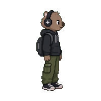
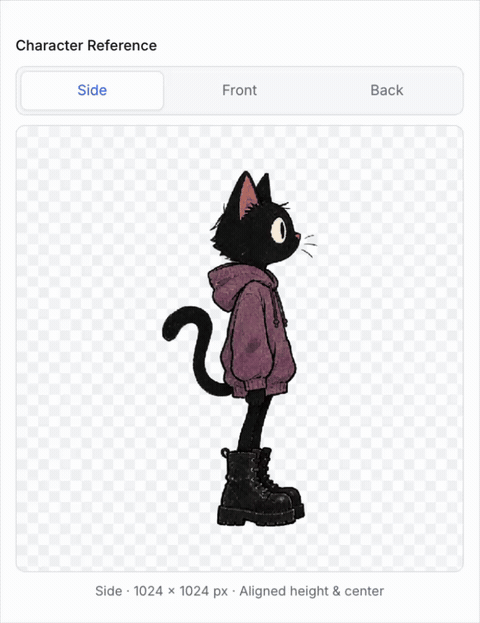
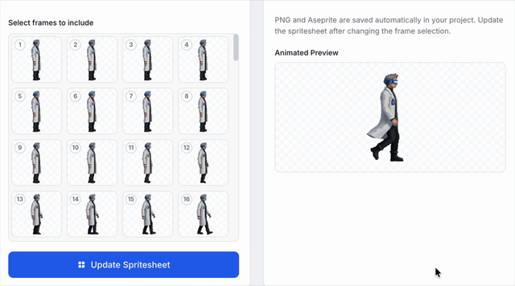
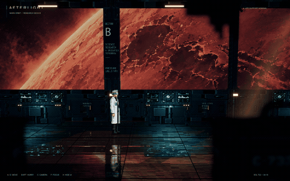

#  Wombo - The AI Game Studio

Wombo is created with the help of Codex and Astra. It allows you to create named characters, animations, and sounds from text prompts. Generate aligned front, side-left, side-right and back references from one turnaround sheet, then create effectively any animation sequence (e.g. idle, walking, fighting) with automatically saved PNG and Aseprite files. Image and video calls go through OpenRouter; Sound & SFX uses ElevenLabs directly from the server.

## Character creation

Describe your character and generate all four views in one image request. A labeled 2×2 template places **Front / Side Left** on the top row and **Side Right / Back** on the bottom row to help keep the character consistent across views.

Attach an image for visual guidance and describe what to use from it, such as its art style or a specific character. Your text controls the subject and requested changes. The layout template is sent first, followed by your optional uploaded image.

The server locally segments the character within each whole grid cell, removes labels, separate grid lines and the green background, and aligns the characters to equal heights, centers and baselines on separate 1024×1024 transparent PNGs. This allows modest variations in placement without cutting off the character at fixed inset margins. Select a view in an animation's **Start image** or **End image** picker to condition on that individual extracted image, subject to the chosen video's model capabilities. New references replace the previous set only after all four views are processed successfully.

Each reference revision preserves `sheet-original.png`, `sheet-template.png`, the four unscaled segmented `*-original.png` crops, and the four aligned PNGs. Failed processing retains the full provider sheet and identifies its revision in the error so it can be inspected or reprocessed locally. Existing characters keep their references until regenerated. The generated sheet must follow the square grid; automatic extraction checks for empty or clipped characters but cannot verify that the model drew the correct angle or kept every design detail consistent.

To extract a saved sheet separately, run `npm run extract:references -- /path/to/sheet.png /path/to/new-output-directory`. This uses the same extraction and alignment code as the server and requires ffmpeg. The editable template is [assets/reference-sheet-template.svg](assets/reference-sheet-template.svg); its checked-in PNG is the image supplied to the model.

Choose an art style from 8-bit Pixel, Cinematic Pixel, Cel-shaded 2D, or Storybook 3D. The selection is saved per character and carries into animation; Custom lets you describe the style in your own prompt.



## Animation creation

Turn your character into an animation, choose the frames to include, and save spritesheets as PNG and Aseprite files.



## Example game: After Light

**After Light** is a 2.5D interplanetary-cyberpunk game currently being built using **Unity + Blender + Astra**, with 2D graphics and sound assets created in Wombo.



[Play the demo here.](https://acatovic.github.io/afterlight-play/)

## Setup and run

Requires Node.js 20+, `ffmpeg`, and `zip` on your PATH.

```bash
npm install
cp .env.example .env
```

In `.env`, set `OPENROUTER_API_KEY` for characters and animations, and `ELEVENLABS_API_KEY` for Sound & SFX. Each workflow only needs its own provider's key.

```bash
npm run dev
```

Open [localhost:5173](http://localhost:5173). Stop the app with `Ctrl+C`.

## Projects and storage

Choose **New Project** or **Open** on startup. Projects live outside the repository in `~/.ai-game-studio/`; set `AI_GAME_STUDIO_HOME` to use another location. Installation creates the storage directory.

```text
<project>/
├── .project               # Project manifest
├── sprites/<character>/   # References and animations/<animation>/
└── music/<sound>/         # Sound settings and audio revisions
```

Generated assets save automatically. **Save project**, switching assets, and **Close project** persist drafts. Each asset's JSON manifest points to its current files; older generated revisions are retained.

Every animation has an `assets/latest/` folder containing `<animation>.png` and `<animation>.aseprite`, copied from the files selected by `animation.json`. It is empty until output is generated. Generation, spritesheet updates, rename, and duplicate keep these convenient copies in sync. Opening an existing project also refreshes them. To backfill all stored animations without changing their manifests, run `npm run backfill:animation-latest`.

Use **Export** in the project header or beside a saved project in **Open** to download the entire project as a ZIP, including manifests and generated assets. Use **Import** on the start screen or in the header to add an exported project from your computer. Import checks the archive and referenced files before placing it in the storage directory. If a project with the same name exists, choose **Replace project**, **Rename import**, or **Cancel**. Replace deletes the existing project's files after the ZIP passes validation.

## Guides

- [Create sprites and animations](docs/create-sprites-and-animations.md)
- [Create music and SFX](docs/create-music-and-sfx.md)
- [AGENTS.md](AGENTS.md) — architecture, implementation rules, and testing.
